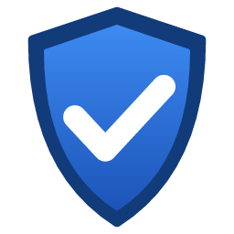

  

<h1 align="center">eMudScan</h1>

  <b>Does your PC still trust the compromised eMudhra certificates?</b> 
  eMudScan checks Windows and the software installed on your PC, and tells you what to do for each one.

  
  
  
  
  

  

In October 2026, the private keys of eight eMudhra intermediate certificate authorities were compromised. Windows, browsers and many programs have since been updated to stop trusting them, but not all of them, and not on every PC. eMudScan finds out where yours stand.

- 📦 **One `.exe`:** nothing to install, no administrator rights.
- 🔒 **Read-only:** it changes nothing on your PC.
- 🌍 **English and French.**

## 📥 Download

Download `eMudScan.exe` from the [latest release](https://github.com/3c0/eMudScan/releases/latest) and run it.

eMudScan is not code-signed yet, so Windows SmartScreen may say it is unrecognised: choose *More info* → *Run anyway*.

## ▶️ Use

1. Tick the drives to scan (local drives are ticked at start).
2. Leave *I accept the online test* ticked, or untick it to scan without any internet connection.
3. Click **Scan**.
4. Double-click a line to see what to do. *Save report* keeps the results in a text file.

Each line gets a coloured shield:

| | Status | Meaning |
|:-:|---|---|
|  | OK | Nothing to do |
|  | Information | Nothing to do, for your information |
|  | Warning | May be affected: worth checking |
|  | Update needed | Accepts the compromised certificates until updated |
|  | Critical | Windows itself still trusts the compromised certificates |

The details window explains why, what to update, and gives the commands to copy. eMudScan never runs them: you decide.

  

## 🔍 What it checks

- 🪟 **Windows:** that it blocks the 16 compromised certificates, offline and with a live test, and whether an antivirus or a proxy inspects secure connections.
- 🌐 **Internet software:** browsers, messaging, mail, sync, VPN and remote-access software.
- 🧰 **Other software:** Python, Java, Node.js, Git, Go, Electron applications, programs with their own certificate list, and every certificate file on the scanned drives.

See [What eMudScan checks](docs/checks.md) for the details.

## 🔒 Privacy

eMudScan connects to the internet only when *I accept the online test* is ticked: 3 connections per scan to emudhra.we-have-a-problem.com, which sees your IP address and your Windows version. Nothing else is sent. See [Privacy](docs/privacy.md).

## 📖 Documentation

- [Using eMudScan](docs/using.md): the window, the statuses, the details and the report
- [What eMudScan checks](docs/checks.md)
- [Privacy](docs/privacy.md)
- [Building and releasing](docs/building.md)
- [Changelog](CHANGELOG.md)

## 🤖 Made with AI

eMudScan was developed by [3c0](https://github.com/3c0) with the help of [Claude Opus](https://www.anthropic.com/claude/opus), Anthropic's AI model.

## ⚖️ License

Copyright © 2026 [3c0](https://github.com/3c0). eMudScan is free software under the [GNU General Public License, version 3 or later](LICENSE).

The reference data comes from [emudhra.we-have-a-problem.com](https://emudhra.we-have-a-problem.com) by Dennis Jackson and contributors ([source](https://github.com/galadran/we-have-a-problem.com), Apache License 2.0).

eMudScan is an independent tool. It is not affiliated with or endorsed by eMudhra, Sectigo, Microsoft, the publishers of the software it checks, or the authors of emudhra.we-have-a-problem.com.
