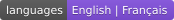
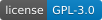
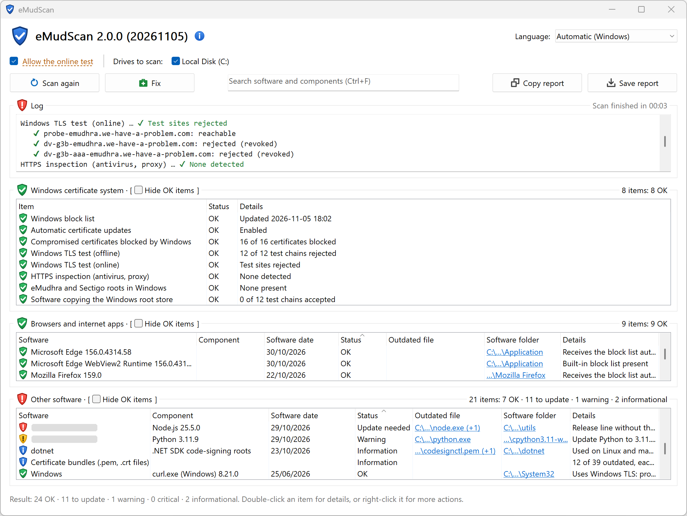
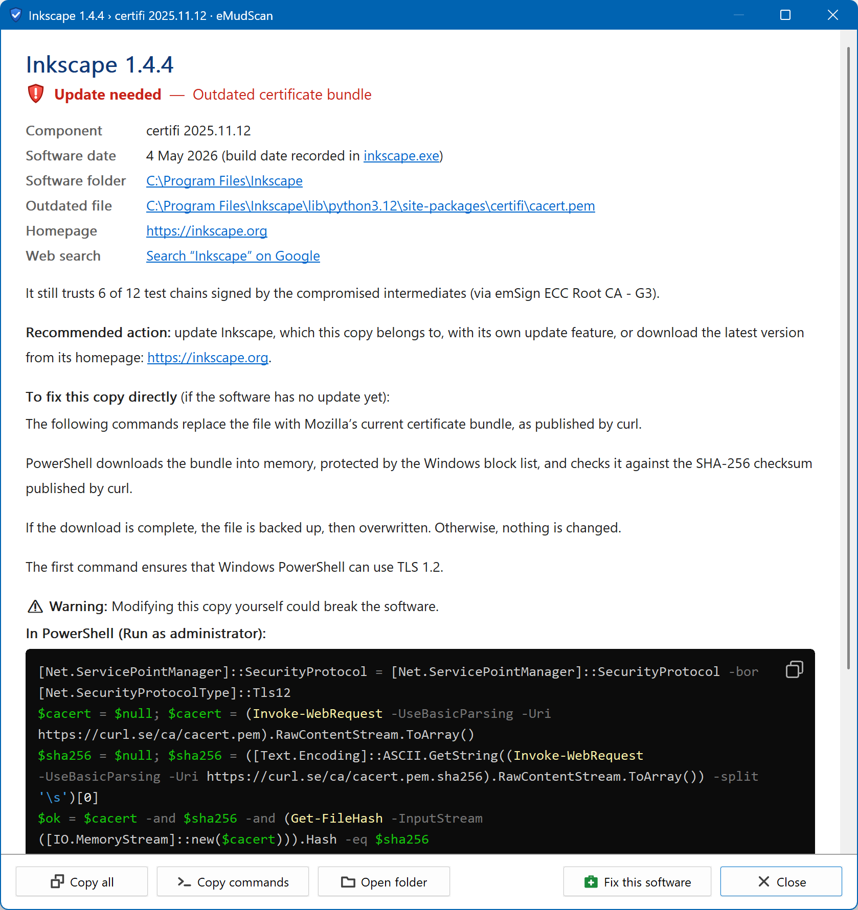
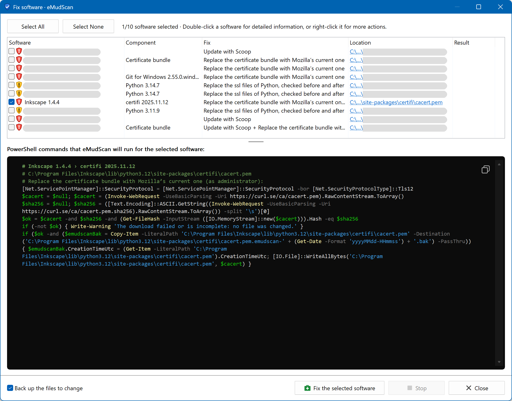

  

<h1 align="center">eMudScan</h1>

  In October 2026, the private keys of eight eMudhra intermediate certificate authorities were found to be compromised. With them, anyone can impersonate any website to software that still trusts them. Windows, browsers and many programs no longer trust them, but not all, and not on every PC. Details: <a href="https://emudhra.we-have-a-problem.com/">we-have-a-problem.com</a>.

  <b>Does your PC still trust the compromised eMudhra certificates?</b> 
  eMudScan checks Windows and the software installed on your PC, 
  tells you what to do about each one, 
  and runs the fixes you select. 
  It is a technical tool for advanced users: security researchers, administrators and developers.

  
  
  
  
  

  

- 📦 **A single `.exe`:** nothing to install, no administrator rights needed to scan.
- 🔒 **You stay in control:** it changes nothing on your PC until you confirm a fix.
- 🌍 **English and French.**

## 📥 Download

Download `eMudScan.exe` from the [latest release](https://github.com/3c0/eMudScan/releases/latest) and run it. It requires Windows 10 version 1809 or later, Windows 11, or Windows Server 2019 or later, and a screen of at least 1024 × 720 once scaled (such as 1920 × 1080 at 150%).

eMudScan is not code-signed, so Windows SmartScreen may show it as an unrecognized app: select **More info**, then **Run anyway**.

The [latest release](https://github.com/3c0/eMudScan/releases/latest) links to the antivirus test results of its `eMudScan.exe`. If your antivirus flags it anyway, see [If your antivirus flags eMudScan.exe](docs/using.md#if-your-antivirus-flags-emudscanexe).

## 🧭 Use

1. Select the drives to scan (local drives are selected by default).
2. Leave **Allow the online test** checked, or clear it to scan without any internet connection.
3. Click **Scan**.
4. Double-click an item to see the recommended action. **Save report** saves the results to a text, JSON or CSV file.
5. Click **Fix** to fix the software that eMudScan can fix, once you accept a warning.

Each item gets a colored shield:

| | Status | Meaning |
|:-:|---|---|
|  | OK | No action needed |
|  | Information | For your information; no action needed |
|  | Warning | May be affected: worth checking |
|  | Update needed | Accepts the compromised certificates until updated |
|  | Critical | Windows itself still trusts the compromised certificates |

The detailed information window explains why, says what to update, and provides the commands to copy. When eMudScan can run them, **Fix this software** does so, once you accept a warning: you decide.

  

## 🔧 Fix

**Fix**, beside **Scan**, lists the software that eMudScan can fix, with the PowerShell commands that will run:

- an update through the package manager that installed the software: Scoop, WinGet, Chocolatey, the Python Install Manager, uv, pipx, pip or conda, or Deno’s own updater;
- Mozilla’s current certificate bundle in place of an outdated one, downloaded from curl.se and checked against its SHA-256 checksum;
- the compromised certificates added to a Java block list;
- the node.exe inside a program replaced with the latest release of its Node.js release line, downloaded from nodejs.org and checked (SHA-256, OpenJS Foundation signature, version), not ticked by default;
- the ssl files of a Python inside a program replaced with those of the fixed release of its line, downloaded from python.org or python-build-standalone and checked (SHA-256, then tests before and after, the original files put back if one fails), not ticked by default.

Nothing runs until you accept a warning, and for the commands that need administrator rights, such as replacing a file in Program Files, Windows also asks your permission. The files are backed up before they are replaced or changed, each software is then checked again, and a report is saved in your Downloads folder. Once a software is fixed, **Restore the backup**, in its details window, puts its files back as they were. See [Fixing software](docs/using.md#fixing-software).

  

## 🔍 What it checks

- 🪟 **Windows:** whether it blocks the 16 compromised certificates, offline and with an online test, and whether an antivirus or a proxy inspects secure connections.
- 🌐 **Browsers and internet apps:** web browsers, messaging, email, sync, VPN and remote-access software.
- 🧰 **Other software:** Python, Java, Node.js, Git, Go, Electron applications, JetBrains’ background service, programs with their own root store, and every certificate bundle on the scanned drives.

See [What eMudScan checks](docs/checks.md) for details.

## 🔒 Privacy

A scan connects to the internet only when **Allow the online test** is checked: 3 connections to emudhra.we-have-a-problem.com, which sees your IP address and your Windows version. Nothing else is sent. A fix connects once you accept it: package managers download their updates from their own sources, and Mozilla’s certificate bundle comes from curl.se. See [Privacy](docs/privacy.md).

## 📖 Documentation

- [Using eMudScan](docs/using.md): the window, the statuses, the detailed information, fixes and the report
- [What eMudScan checks](docs/checks.md)
- [Software listed by we-have-a-problem.com](docs/coverage.md): how eMudScan checks each one
- [Privacy](docs/privacy.md)
- [Building and releasing](docs/building.md)
- [Contributing](.github/CONTRIBUTING.md): issues, pull requests, and the rules eMudScan follows
- [Roadmap](docs/roadmap.md): what the next versions will bring
- [Changelog](CHANGELOG.md)

## 🤖 Made with AI

eMudScan was developed by [3c0](https://github.com/3c0) with the help of [Claude](https://claude.com/), Anthropic’s AI.

## 📜 License

Copyright © 2026 [3c0](https://github.com/3c0). eMudScan is free software, licensed under the [GNU General Public License, version 3 or later](LICENSE).

The reference data comes from [emudhra.we-have-a-problem.com](https://emudhra.we-have-a-problem.com) by Dennis Jackson and contributors ([source](https://github.com/galadran/we-have-a-problem.com), Apache License 2.0).

eMudScan is an independent tool. It is not affiliated with or endorsed by eMudhra, Sectigo, Microsoft, the publishers of the software it checks, or the authors of emudhra.we-have-a-problem.com.
