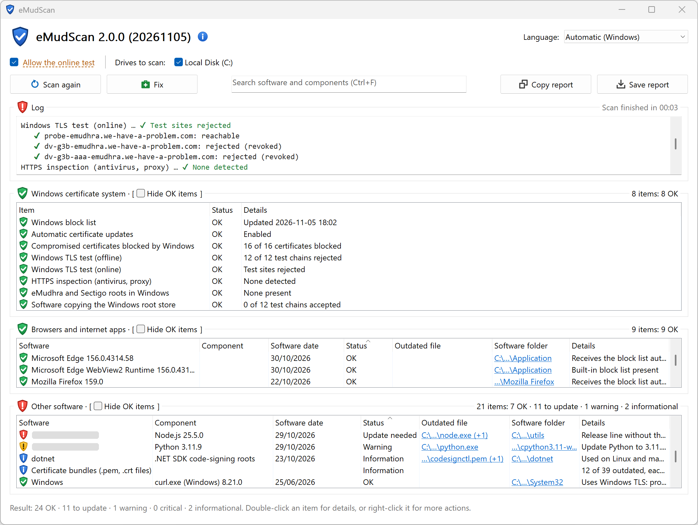
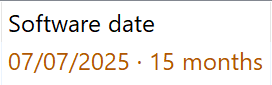
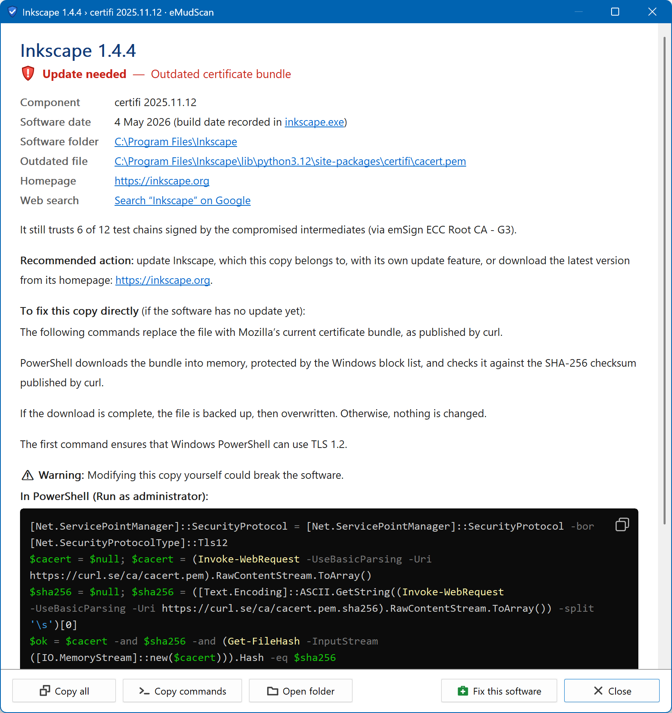
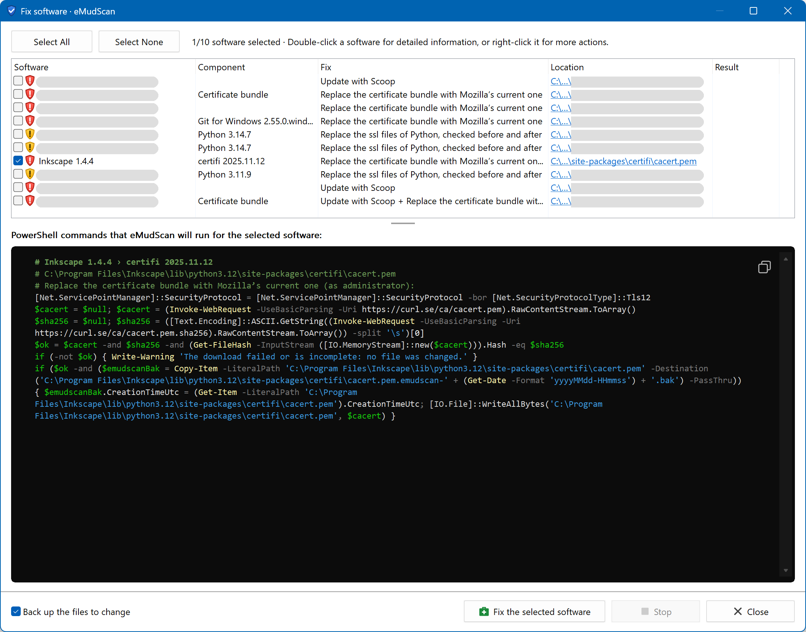
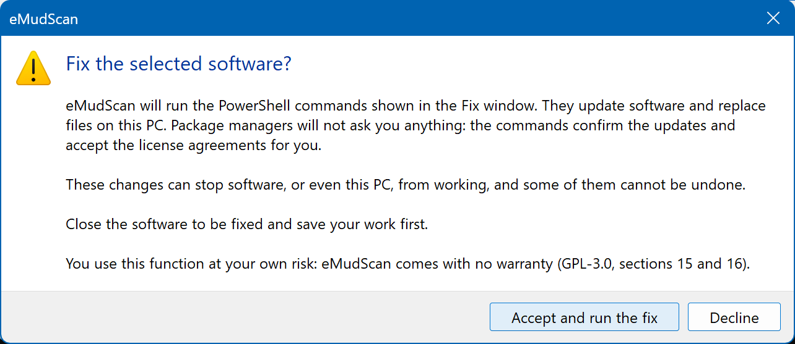
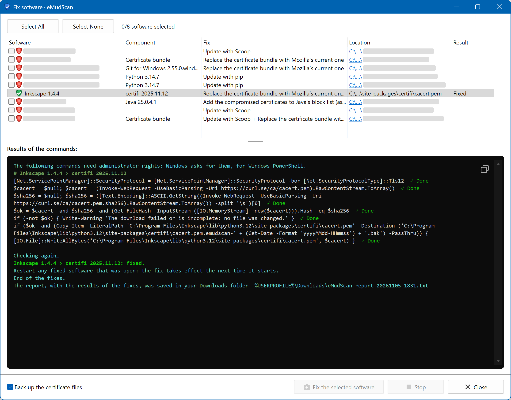
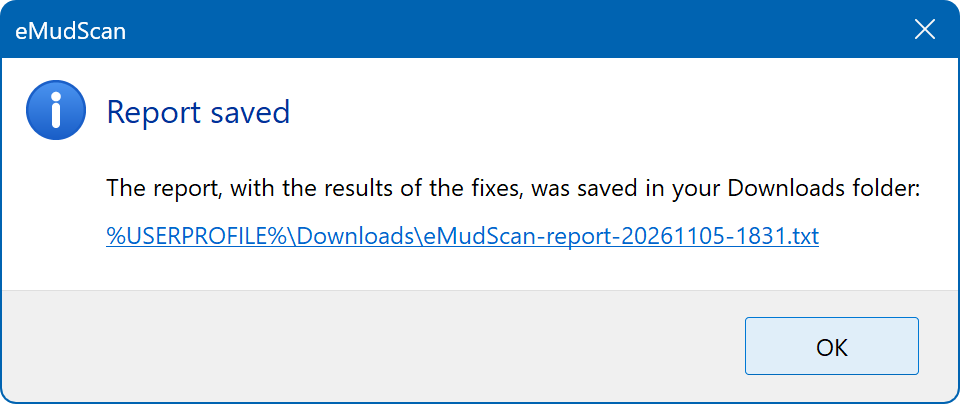

# Using eMudScan

## The window

  

From top to bottom:

- **eMudScan and its version.** The ⓘ icon opens the About box: author, online
  test, privacy, credits, licenses and disclaimer. **Language** (top right):
  Automatic (Windows), English or Français. Changing it resets the window; the
  choice is not saved.
- **Allow the online test**: checked by default. Hover over it to see what is
  sent; clear it to scan without any internet connection (see [Privacy](privacy.md)).
- **Drives to scan**: local drives are selected by default; DVD, removable and
  network drives are not. Nothing on an unselected drive is read or reported.
- **Scan** starts the scan (it never starts on its own). It becomes **Stop**
  during the scan, then **Scan again**. **Fix**, beside it, fixes the software
  that eMudScan can fix (see [Fixing software](#fixing-software)). **Copy report**
  and **Save report** are on the right.
- **Log**: one line per step. You can select and copy its text. The shield
  before its title is animated while the scan runs, then shows the worst status
  that the scan found. The right end of its top line shows what the scan is
  reading and the time, then how long the scan took.
- Three lists: **Windows certificate system**, **Browsers and internet apps**
  (browsers, messaging, email, sync, VPN, remote access…) and **Other software**
  (everything else). Drag the borders between them to resize them. The shield
  before the title of each list shows the worst status of its items (a grey one
  before the scan), and the right end of its top line counts them by status.
  **Hide OK items**, after the title, hides the OK items of a list, which its top
  line still counts (“5 OK (hidden)”).

## Statuses

In the lists, each status has a shield; the log and the report use a symbol.

| Shield | Symbol | Status | Meaning |
|:-:|:-:|---|---|
|  | ✅ | OK | No action needed |
|  | ℹ | Information | For your information; no action needed |
|  | ⚠ | Warning | May be affected: worth checking |
|  | ❗ | Update needed | Accepts the compromised certificates until updated |
|  | ❌ | Critical | Windows itself still trusts the compromised certificates |

## The software lists

- **Software**: the software as you know it, with its version and, when it was
  installed with a package manager or from the Microsoft Store, how it was
  installed (`hugo 0.152.2 [Scoop]`). For a part of a program (when the
  **Component** column is filled in), the version is the program’s, as shown in
  **Apps & features** or by its package manager, so that all the parts of a
  program show the same version.
- **Component**: the part being checked (certifi, Electron, Java…); empty when
  the software itself is checked.
- **Software date**: when the publisher last updated the software
  ([how it is determined](checks.md#software-date)). When the software needs an
  update and is 12 months old or more, the date is shown in amber with its age:
  a newer version may exist, or the software may no longer be maintained.

  

- **Status**, **Outdated file**, **Software folder** and **Details**.

The same finding in several places (two copies of Node.js inside the same
program) is a single item: its **Outdated file** ends with *(+1)*, and its
details list every copy. **Scan again** checks each copy; copies that no longer
match get their own items again.

Click a column header to sort, click a path to open it in File Explorer, and
hover over a cell to see its full content.

The search box above the lists (Ctrl+F) keeps the items whose **Software** or
**Component** column contains every word typed, in any order or case, including
versions and package managers (`node 22`, `certifi`, `scoop`). Once a scan
is finished, it has the focus: just type. The right
end of the top line of each list then counts the items found ("Search found 2
items: …"), and its shield shows their worst status. Esc clears it, as do
**Scan** and **Scan again**.

Right-click one or more items for: **Details**, **Open file location**, **Open
software folder**, **Open homepage**, **Search on Google**, **Scan again**,
**Copy**, **Copy paths** and **Select all**. **Scan again** first reads the
installed software again, so a program you have just updated shows its new
version.

## The details window

Double-click an item (or press Enter) to see its software date and where that
date comes from, its folders, homepage and package, and the **recommended
action**. Commands are shown in black blocks, with a copy button, for you to run.
When eMudScan can run them for you, **Fix this software** does so, once you
confirm (see [Fixing software](#fixing-software)).

A path in your user folder is shown with the variable that names that folder, as
File Explorer understands it: `%USERPROFILE%`, `%APPDATA%` or `%LOCALAPPDATA%`
(`%LOCALAPPDATA%\Programs\App\app.exe`). So are the paths of the report, the log
and the Fix window, and the commands name the folder as PowerShell does
(`"$env:LOCALAPPDATA\Programs\App\app.exe"`): they are shorter, and your user name
stays out of them. The links and the copied paths keep the full path.

  

Before changing a file, these commands back it up next to the original, with
the date and time in its name (`cacert.pem.emudscan-20261031-011500.bak`). As
long as such a backup exists, the details window offers a command to restore it,
and **Restore the backup** to run it for you (see
[Restoring a backup](#restoring-a-backup)).

In C:\ProgramData, any user can create folders, and often add files to the
folders of others, so a program or a backup there may have been put there by
someone else. For files that need administrator rights, eMudScan therefore gives
the pip commands and the restore command only when the files and their folders
belong to administrators, SYSTEM, TrustedInstaller or you, and gives no pip
command for a Python whose folders other users can add files to: Python would
load what they put there.

For a browser that may not be protected, links open the advisory’s test pages in
that browser, so that you can check for yourself. eMudScan starts only a browser
registered in Windows or kept in a folder that only administrators or you can
change (Program Files, Windows, your user folder): for another one, the details
give the pages’ addresses to open in it.

## Fixing software

eMudScan can run for you the commands that the details give to fix a software,
and no others:

- an update through the package manager that installed the software or its
  component: Scoop, WinGet, Chocolatey, pip or conda;
- an outdated certificate bundle replaced with Mozilla’s current one, which
  PowerShell downloads from curl.se and checks against the SHA-256 checksum that
  curl publishes;
- the compromised certificates added to a Java block list.

The other commands of the details, such as removing a setting, are left for you
to run; restoring a backup has its own button (see
[Restoring a backup](#restoring-a-backup)). Software that only its publisher,
Windows Update, the Microsoft Store or a network administrator can fix is not
listed: its details say what to do.

**Fix**, beside **Scan**, is enabled once a scan has found software that eMudScan
can fix. It opens the **Fix software** window, with, from top to bottom:

- **Select All**, **Select None**, and how many software are selected.
- The software that eMudScan can fix, all ticked, with its vulnerable component,
  the fix, its location and, after the fixes, the result. A software found in
  several places has a row for each. Click a location to show it in File
  Explorer. Drag the bar below the list to make it taller or shorter, down to a
  single row.
- The PowerShell commands that will run for the ticked software, or for the
  software you click. The button in their top right corner copies them, with
  their comments, as in the details window; after the fixes, it copies their
  results. You can also select part of the text and copy it (Ctrl+C, or
  right-click).
- **Back up the certificate files**, **Fix the selected software**, **Stop**
  and **Close**.

  

**Fix this software**, in the details window, opens the same window for that
software alone, without the list; its button is **Run the fix now**.

**Back up the certificate files**, ticked by default, backs up each certificate
bundle and Java block list before it is replaced or changed, next to the
original, as the details window does (see above). It does not cover the updates
made by package managers.

Nothing runs until you accept a warning, which says what the commands do: they
update software and replace files; package managers will not ask you anything,
as the commands confirm the updates and accept the license agreements for you;
and some changes cannot be undone. **Decline** is its default button. Close the
software to fix and save your work first.

  

Once you accept:

1. The updates through Scoop, WinGet and Chocolatey run first; then, for the
   software that they did not fix, the other fixes.
2. The commands that need administrator rights run in a Windows PowerShell for
   which Windows asks your permission: its prompt shows Microsoft as the
   verified publisher. eMudScan itself does not need them.
3. The console shows each command with its result at the end of its line
   (“✓ Done”), then what it showed, and a blank line after the commands of each
   software. **Stop** never stops a command in the middle: Windows PowerShell
   first ends the commands it was given (those of one software, or all those
   that need administrator rights), then a red line says “Fix interrupted!”, and
   the software not reached is left as it was.
4. Each software is checked again: the console and the **Result** column say
   whether it is fixed, and the lists show its new status. A fixed software
   loses its check box, so that it is not fixed twice: **Select All** leaves it
   out, and the count of selected software no longer includes it.
5. A last line reminds you to restart any fixed software that was open: the fix
   takes effect the next time it starts.

  

The **Fix software** window then saves the report in your Downloads folder, and
gives its path as a link that shows it in File Explorer.

  

To try the Fix function without changing anything, build the simulation: see
[Building and releasing](building.md#building-on-your-pc).

### Restoring a backup

Once a software has nothing left to fix, and as long as eMudScan’s backups of its
files are there, **Fix this software**, in its details window, becomes **Restore
the backup** (or **Restore the backups**). Nothing changes until you accept a
warning, which says that the software will then trust the compromised
certificates again. eMudScan then moves each backup back in place of its file, as
the command of the details does. A file in a folder that only administrators can
change, such as Program Files, is moved by that command, in a Windows PowerShell
for which Windows asks your permission: eMudScan itself does not need
administrator rights. The software is then checked again, and a message says
whether its files are back; if it needs fixing, its details offer **Fix this
software** again. The report keeps what was done.

## The report

**Copy report** and **Save report** (UTF-8 text) include every item, with the
same explanations as the details windows and, after fixes, the commands that ran
and what they showed. Apart from the fixes, saving a report is the only time
eMudScan writes a file.

## Keyboard shortcuts

| Keys | Action |
|---|---|
| F5 | Scan, or scan again |
| Ctrl+S | Save the report |
| Ctrl+Shift+C | Copy the report |
| Ctrl+F | Search the lists |
| Ctrl+Q | Quit eMudScan |
| Enter | Show the details of the selected items |
| Esc | Close the details window |
| Ctrl+C, Ctrl+A | In a list: copy the selected items, select all |

Hover over the **Scan**, **Copy report** and **Save report** buttons to see
their keyboard shortcuts.

## The About box

The ⓘ icon next to the version opens it: what eMudScan does, who made it, its
license, what fixes change and connect to, the online test and what it sends
(including your Windows edition and version), the reference data and the
disclaimer. **Licenses and notices** shows the full license texts.

## Command line

- `--en`, `--fr`: the language for this session.
- `--offline`: start with **Allow the online test** cleared.

## If your antivirus flags eMudScan.exe

Some antivirus programs flag new programs that are not code-signed yet, such as
eMudScan, even though they contain no malware: a false positive. To check your
copy of `eMudScan.exe`:

- Its SHA-256 must match the one on its
  [release page](https://github.com/3c0/eMudScan/releases). In PowerShell:
  `Get-FileHash eMudScan.exe`.
- The release page links to the results of an antivirus scan of
  `eMudScan.exe` made on the release date.
- With the [GitHub CLI](https://cli.github.com/), you can verify that GitHub
  built it from eMudScan’s source code:
  `gh attestation verify eMudScan.exe -R 3c0/eMudScan`.

Only your antivirus’s publisher can fix a false positive: report the file to
them, usually through a form on their website. eMudScan’s author cannot change
what an antivirus reports, so please do not report false positives in
eMudScan’s issues.

You can also build `eMudScan.exe` yourself from its source code: see
[Building and releasing](building.md).
