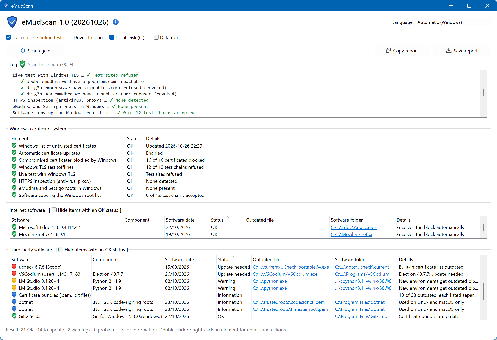
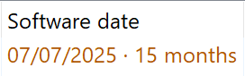
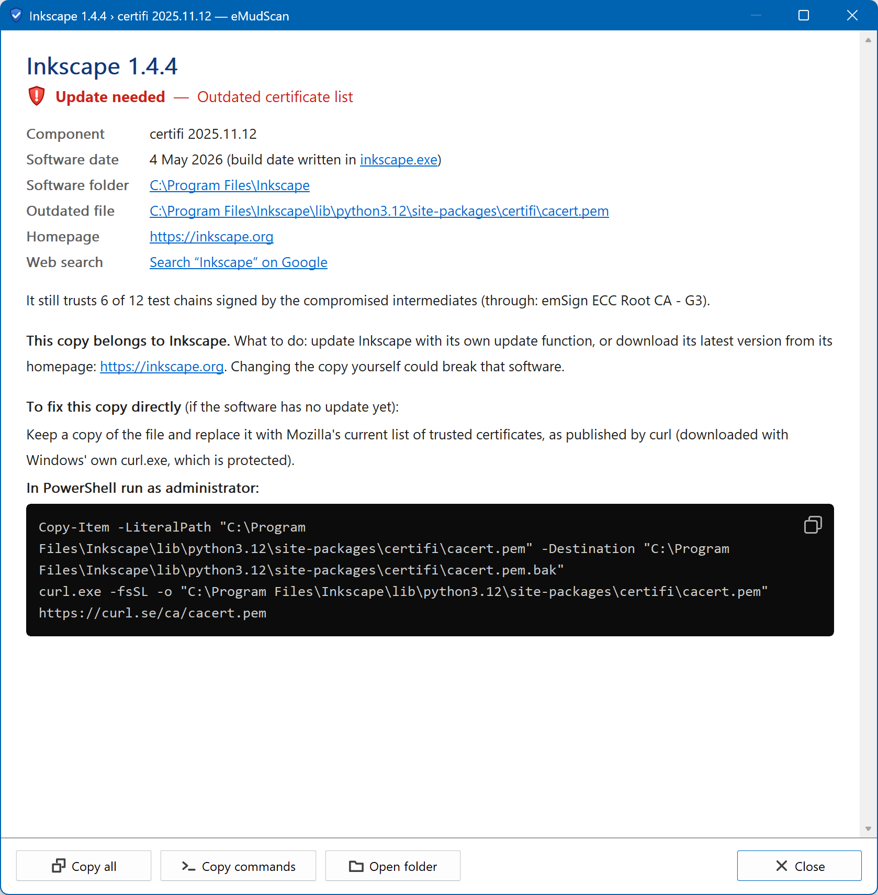
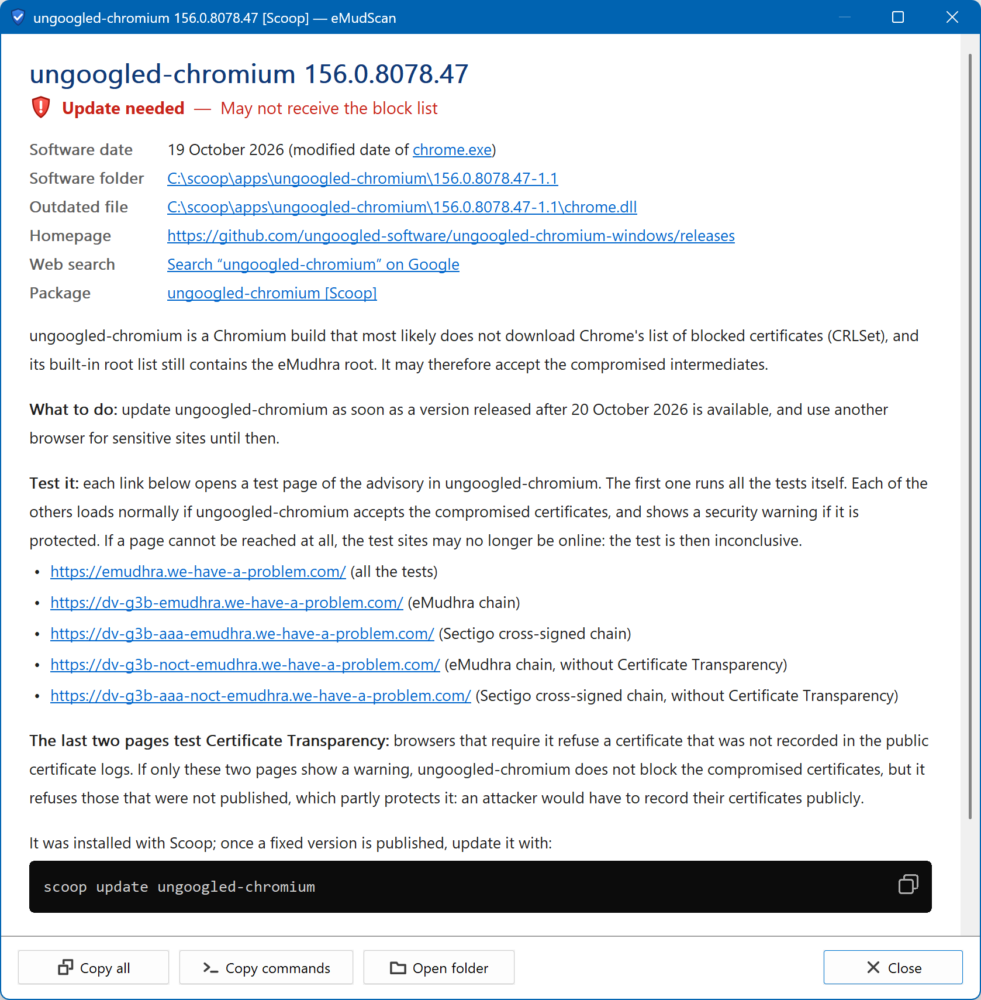
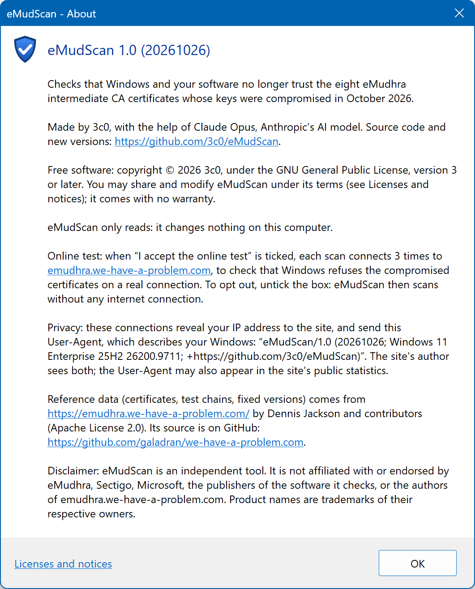

# Using eMudScan

## The window

  

From top to bottom:

- **eMudScan and its version.** The ⓘ icon opens the About box: author, online
  test, privacy, credits, licenses and disclaimer. **Language** (top right):
  Automatic (Windows), English or Français. Changing it resets the window; the
  choice is not saved.
- **Allow the online test**: ticked at start. Hover it to see what is sent;
  untick it to scan without any internet connection (see [Privacy](privacy.md)).
- **Drives to scan**: local drives are ticked at start; DVD, removable and network
  drives are not. Nothing on a drive that is not ticked is read or reported.
- **Scan** starts the scan (it never starts on its own). It becomes **Stop**
  during the scan, then **Scan again**. **Copy report** and **Save report** are on
  the right.
- **Log**: one line per step. Text can be selected and copied.
- Three lists: **Windows certificate system**, **Browsers and internet apps** (browsers,
  messaging, mail, sync, VPN, remote access…) and **Other software**
  (everything else). Drag the borders between them to resize them.

## Statuses

In the lists, each status has a shield; the log and the report use a mark.

| Shield | Mark | Status | Meaning |
|:-:|:-:|---|---|
|  | ✅ | OK | Nothing to do |
|  | ℹ | Information | Nothing to do, for your information |
|  | ⚠ | Warning | May be affected: worth checking |
|  | ❗ | Update needed | Accepts the compromised certificates until updated |
|  | ❌ | Critical | Windows itself still trusts the compromised certificates |

## The software lists

- **Software**: the software you know, with its version and how it was installed,
  when that is a package manager or the Microsoft Store (`tesseract 5.5.1 [Scoop]`).
  For a part of a program (the *Component* column is filled), the version is the
  program's as Windows lists it in Apps & features or its package manager does, so
  all the parts of a program show the same one.
- **Component**: the part that is checked (certifi, Electron, Java…); empty when
  the software itself is checked.
- **Software date**: when the publisher last updated the software
  ([how it is found](checks.md#software-date)). When the software needs an update
  and is 12 months old or more, the date is in amber with its age: a newer
  version may exist, or the software may no longer be maintained.

  

- **Status**, **Outdated file**, **Software folder** and **Details**.

The same finding in several places (two copies of Node.js inside LM Studio) is one
row: its *Outdated file* ends with *(+1)*, and its details list every copy. *Scan
again* checks each copy; copies that no longer agree get their own rows again.

Click a header to sort, click a path to open it in Explorer, hover a cell to see
it in full. *Hide OK items* filters a list.

The search box above the lists (Ctrl+F) keeps the rows whose *Software* or
*Component* column contains every word typed, in any order and case, versions
and package managers included (`lm studio node`, `check`, `scoop`). Esc clears
it, and so does *Scan* or *Scan again*.

Right-click one or more rows for: Details, Open file location, Open software
folder, Open homepage, Search on Google, Scan again, Copy, Copy paths, Select all.
*Scan again* reads the installed software again first, so a program you have just
updated shows its new version.

## The details window

Double-click a row (or press Enter) to see the item, its software date and
where that date comes from, its folders, homepage and package, and **what to
do**. Commands are shown in black blocks, with a copy button. eMudScan never runs
them: you decide.

  

For a browser that is not protected, links open the advisory's test pages in that
browser, so you can see for yourself.

  

## The report

*Copy report* and *Save report* (UTF-8 text) give every item with the same
explanations as the details windows. Saving a report is the only time eMudScan
writes a file.

## Keyboard shortcuts

| Keys | Action |
|---|---|
| F5 | Scan, or Scan again |
| Ctrl+S | Save report |
| Ctrl+Shift+C | Copy report |
| Ctrl+F | Search the lists |
| Ctrl+Q | Quit eMudScan |
| Enter | Details of the selected rows |
| Esc | Close the details window |
| Ctrl+C, Ctrl+A | In a list: copy the selected rows, select all |

Hover the *Scan*, *Copy report* and *Save report* buttons to see their keyboard
shortcut.

## The About box

The ⓘ icon next to the version opens it: what eMudScan does, who made it, its
license, the online test and what it sends, the reference data and the
disclaimer. *Licenses and notices* shows the full texts of the licenses.

  

## Command line

- `--en`, `--fr`: the language for this run.
- `--offline`: start with the online test unticked.
