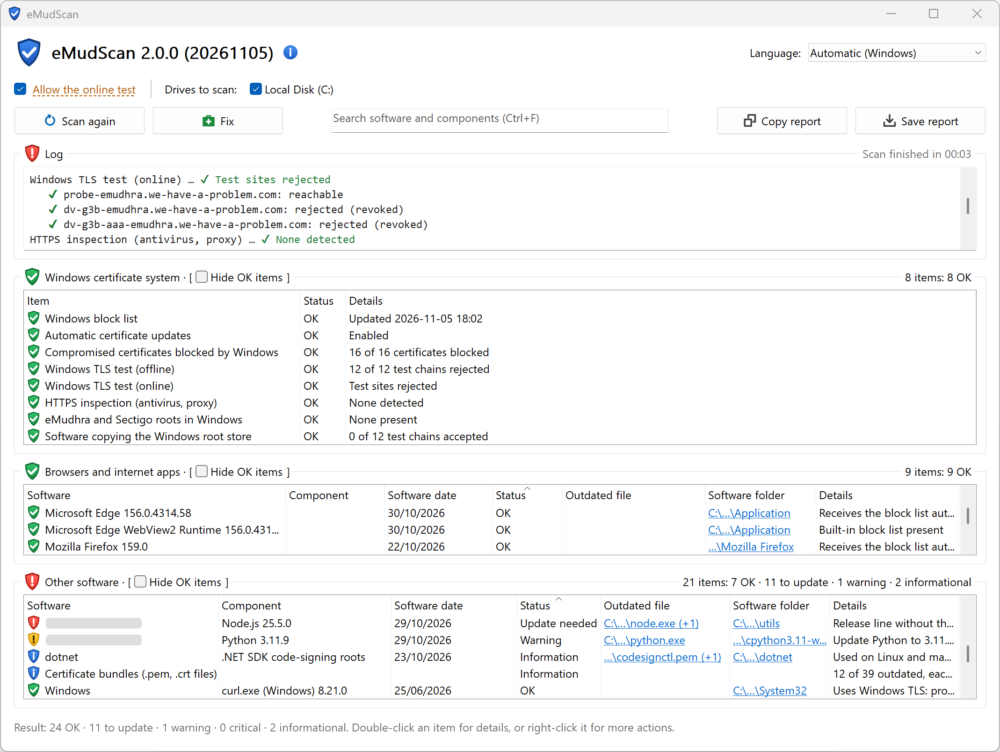
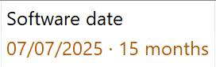
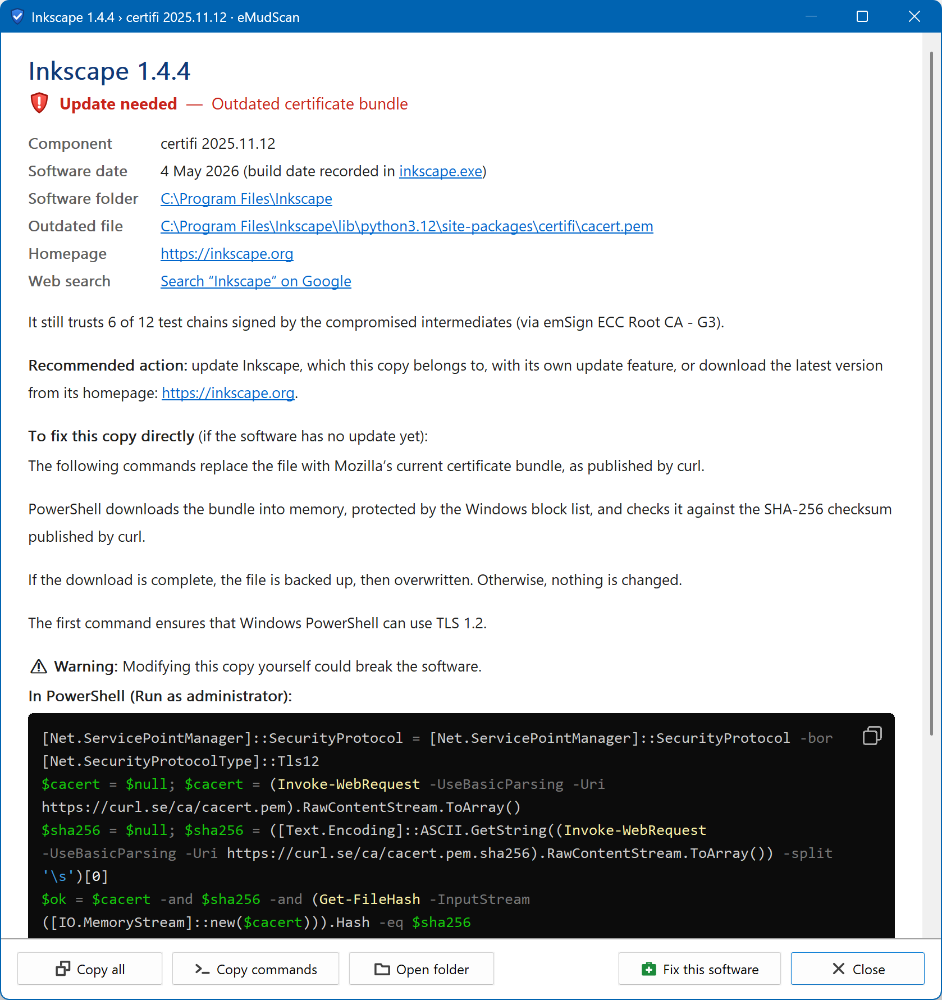
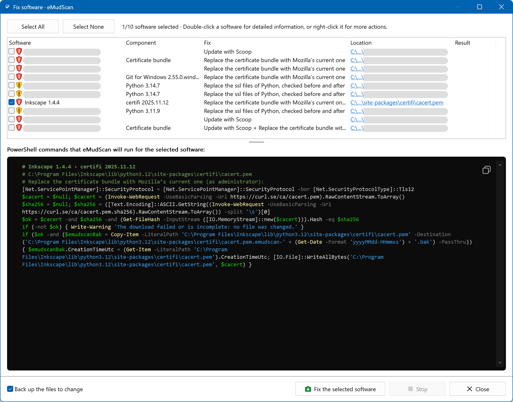
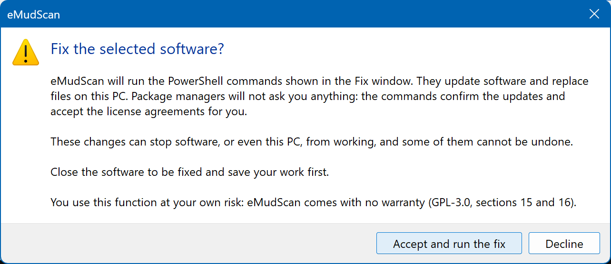
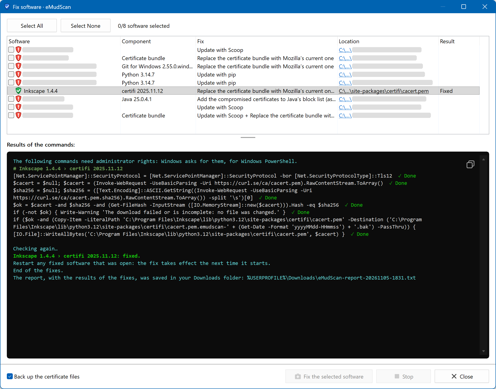

# Using eMudScan

## The window

<p align="center">
  
</p>

- **Language** (top right): Automatic (Windows), English or Français. The choice
  is not saved.
- **Online checks and updates**: checked by default. Clear it to scan without
  any internet connection (see [Privacy](privacy.md)).
- **Drives to scan**: the local drives are selected by default. Nothing on an
  unselected drive is read.
- **Scan** starts the scan: it never starts on its own.
- **Fix** fixes the software that eMudScan can fix (see
  [Fixing software](#fixing-software)).
- **Copy report** and **Save report**: see [The report](#the-report).
- Three lists: **Windows certificate system**, **Browsers and internet apps**
  (browsers, messaging, email, sync, VPN, remote access…) and
  **Other software**. The shield of each list shows the worst status of its
  items.
- The ⓘ icon opens the About box: author, privacy, licenses, and
  **Check for updates** (see [Updates](#updates)).

## Statuses

In the lists, each status has a shield; the log and the report use a symbol.

| Shield | Symbol | Status | Meaning |
|:-:|:-:|---|---|
|  | ✅ | OK | No action needed |
|  | ℹ | Information | For your information; no action needed |
|  | ⚠ | Warning | May be affected: worth checking |
|  | ❗ | Update needed | Accepts the compromised certificates until updated |
|  | ❌ | Critical | Windows itself still trusts the compromised certificates |

## The software lists

- **Software**: its name, its version and, when it was installed with a package
  manager or from the Microsoft Store, how (`hugo 0.152.2 [Scoop]`).
- **Component**: the part being checked (certifi, Electron, Java…); empty when
  the software itself is checked.
- **Software date**: when the publisher last updated the software
  ([how it is determined](checks.md#software-date)). It is in amber, with its
  age, when the software needs an update and is 12 months old or more: it may no
  longer be maintained.

  

- **Status**, **Outdated file**, **Software folder** and **Details**.

A finding in several places, such as two copies of Node.js inside the same
program, is a single item: its **Outdated file** ends with *(+1)*, and its
detailed information lists every copy.

The search box (Ctrl+F) keeps the items whose **Software** or **Component**
contains every word typed, in any order: `node 22`, `certifi`, `scoop`. Esc
clears it.

Click a path to show it in File Explorer. Right-click one or more items to open
their file location, folder or homepage, search for them on Google, scan them
again, copy them or fix them.

## The detailed information window

Double-click an item (or press Enter) to see where it is, its software date, its
homepage and the **recommended action**, with the PowerShell commands to copy
and run. When eMudScan can run them for you, **Fix this software** does so, once
you confirm (see [Fixing software](#fixing-software)).

Commands marked **(Run as administrator)** need a PowerShell opened with
**Run as administrator**. The **Fix this software** button asks for these rights
itself.

With several items selected, Enter opens one window for all of them: Alt+← and
Alt+→ go from one item to the next.

<p align="center">
  
</p>

- **Paths.** A path in your user folder is shown with `%USERPROFILE%`,
  `%APPDATA%` or `%LOCALAPPDATA%`, also in the report and the log: your user
  name stays out of them.
- **Backups.** Before changing a file, the commands back it up next to the
  original, with the date and time in its name
  (`cacert.pem.emudscan-20261031-011500.bak`). See
  [Restoring a backup](#restoring-a-backup).
- **Files that other users can change.** eMudScan gives no pip command and no
  restore command to run as administrator when another user of the PC could have
  put or changed the files, as in some folders of C:\ProgramData.
- **Browsers.** For a browser that may not be protected, links open the test
  pages of we-have-a-problem.com in that browser, so that you can check for
  yourself.

## Fixing software

**Fix**, beside **Scan**, opens the **Fix software** window once a scan has
found software that eMudScan can fix. **Fix** in the right-click menu of the
lists opens it for the selected items only. The fixes are those of the detailed
information:

- an update through the package manager that installed the software: Scoop,
  WinGet, Chocolatey, the Python Install Manager, uv, pipx, pip or conda, or
  Deno’s own updater;
- an outdated certificate bundle replaced with Mozilla’s current one, downloaded
  from curl.se and checked (SHA-256);
- the compromised certificates added to a Java block list;
- the node.exe inside a program replaced with the latest release of its Node.js
  release line, downloaded from nodejs.org and checked (SHA-256, OpenJS
  Foundation signature, version);
- the ssl files of a Python inside a program replaced with those of the latest
  release of its line, downloaded from python.org or python-build-standalone and
  checked (SHA-256, then tests before and after: the original files are put back
  if one fails).

The last two change a program that its publisher has not updated yet: they are
not ticked by default. See [Other software](checks.md#other-software).

Software that only its publisher, Windows Update, the Microsoft Store or a
network administrator can fix is not listed: its detailed information says what
to do.

The window shows the PowerShell commands that will run, each software fix in a
separate block. In the fix of a Python, `check_ssl.py` is a link to the tests
that the fix runs in that Python.

<p align="center">
  
</p>

**Back up the files to change**, ticked by default, backs up each file before it
is replaced or changed, next to the original. It does not cover the updates made
by package managers.

Nothing runs until you accept a warning. Package managers will not ask you
anything: the commands confirm the updates and accept the license agreements for
you. Some changes cannot be undone. Close the software to fix and save your work
first.

<p align="center">
  
</p>

Once you accept:

1. The updates run first, then the other fixes, for the software that the
   updates did not fix.
2. The commands run in Windows PowerShell 5.1 or, on a PC without it, in
   PowerShell 7 installed in Program Files. For those that need administrator
   rights, Windows asks your permission: once for the updates, once for the
   other fixes.
3. Each command gets a green ✔ or a red ✘. A fix stops at its first command that
   fails; the other fixes still run. A failed connection stops them all.
4. **Stop** lets the running fix end, then leaves the remaining software as it
   was.
5. Each software is checked again: the **Result** column says whether it is
   fixed. A software still not fixed is unticked: tick it to run its fixes
   again.
6. The report is saved in your Downloads folder.

Restart any fixed software that was open: the fix takes effect the next time it
starts.

<p align="center">
  
</p>

To try the Fix function without changing anything, build the simulation: see
[Building and releasing](building.md#building-on-your-pc).

### Restoring a backup

Once a software is fixed, and as long as its backups are there,
**Fix this software** becomes **Restore the backup** in its detailed information
window. Once you accept a warning, the files are put back as they were: the
software then trusts the compromised certificates again.

## The report

**Copy report** and **Save report** include every item with its explanation,
without the commands. After fixes, the report also gives their results.

Its top gives eMudScan’s version, the date, the name of your PC and its Windows
version. Before you share a report, remove what you want to keep private, such
as the name of your PC or your user name in the paths.

A saved report is named after your PC, the date and the time:
`eMudScan-report-MY-PC-20261201-101548.txt`. The log ends with a link to each
report saved since the last scan.

**Save report** lets you choose the type of the file:

| Type | File | Use |
|---|---|---|
| Text | `.txt` | To read: it is what **Copy report** copies |
| JSON | `.json` | For other programs: every item with all its fields |
| CSV | `.csv` | For a spreadsheet: one row for each item |

The files are in UTF-8; the text and the CSV start with a byte order mark, for
Notepad and Excel. In the JSON and CSV files, the names of the fields and the
keywords are in English in both languages; the texts are in the language of the
window.

### The JSON file

| Field | Content |
|---|---|
| `format`, `format_version` | `emudscan-report` and `2`. The version changes when a field is removed or changes meaning, not when a field is added. Version 1 also gave the commands of the fixes |
| `tool` | eMudScan: `name`, `version`, `date` and `url`. A build that is not a release has `commit` instead of `date` |
| `created` | When the report was made, such as `2026-12-01T10:15:48+01:00` |
| `language` | `en` or `fr`: the language of the texts |
| `pc` | `name` and `windows`: the name of the PC and its Windows version |
| `scan` | `online_test`: the online test was allowed. `drives`: the drives scanned. `seconds`: how long the scan took. `complete`: `false` when the scan was stopped |
| `worst_status` | The worst status of the items |
| `counts` | The number of items of each status |
| `items` | The items, in the order of the text report |
| `fixes_run` | After fixes: the lines of the Fixes section of the text report, which says what came of them |
| `log` | The lines of the log |

Each item has these fields; a field without a value is left out:

| Field | Content |
|---|---|
| `group` | Its list: `windows`, `internet` or `other` |
| `status` | `ok`, `information`, `warning`, `update_needed` or `critical` |
| `program`, `program_version` | The software. For a check of Windows: `Windows` |
| `component`, `component_version` | The part that is checked, when it is not the program itself. For a check of Windows: the name of the check |
| `summary` | The Details column of the lists |
| `details` | The explanation of the detailed information window, as text, without its commands |
| `software_date` | The Software date column, such as `2026-03-02` |
| `file`, `folder` | The outdated file, or the file checked when the item is OK, and the software folder |
| `homepage` | The homepage of the software |
| `packages` | The packages of the software: `manager`, `id` and `page` |
| `copies` | When the same finding is in several places, the other places: `file` and `folder` |
| `fixes` | What **Fix** can run: `kind`, `manager` (for an update), `optional` (not ticked when the Fix window opens) and `administrator` (needs administrator rights) |

The kinds of fixes are `update` (with the package manager), `pip`, `conda`,
`tool`, `replace_bundle`, `java_block_list`, `replace_node` and
`replace_python_ssl`. An item whose check did not end has the status `unknown`,
which is also the worst status of a report without items.

### The CSV file

One row of column names, then one row for each item, with commas, whatever the
regional settings of Windows:

`pc`, `windows`, `created`, `tool_version`, `group`, `status`, `program`,
`program_version`, `component`, `component_version`, `summary`, `software_date`,
`file`, `folder`, `copies`, `fix`

The values are those of the JSON fields. `copies` gives the other places of the
finding, and `fix` the kinds of its fixes, separated by ` | `. The explanations
and the log are only in the text and JSON files.

A value that starts with `=`, `+`, `-` or `@` gets an apostrophe before it, so
that a spreadsheet does not run it as a formula. If Excel shows each row in one
cell, as with French regional settings, import the file with **Data** >
**From Text/CSV**.

## Keyboard shortcuts

| Keys | Action |
|---|---|
| F5 | Scan, or scan again |
| Ctrl+S | Save the report |
| Ctrl+Shift+C | Copy the report |
| Ctrl+F | Search the lists |
| Ctrl+Q | Quit eMudScan |
| Enter | Show the detailed information of the selected items |
| Esc | Close the detailed information window |
| Alt+←, Alt+→ | In the detailed information of several items: previous, next item |
| Alt+Home, Alt+End | In the detailed information of several items: first, last item |
| Ctrl+C, Ctrl+A | In a list: copy the selected items, select all |
| Tab, Shift+Tab | The next control, the one before; inside a text, its links and copy buttons first |
| Enter, Space | On a link or a copy button reached with Tab: open the link, copy |

## Updates

With **Online checks and updates** checked, eMudScan looks for a new version of
itself at the first scan of a session, and when you click **Check for updates**
in the About box. A new version is offered with its release notes: click
**Update now** to install it, or **Not now** to return to the main window.

**Update now** downloads the new `eMudScan.exe` from GitHub and checks it
(immutable release, SHA-256) before it replaces yours. If the folder of
`eMudScan.exe` needs administrator rights, such as Program Files, Windows asks
for them. No backup of the old version is kept.

`eMudScan-cli.exe` never updates itself. See
[Privacy](privacy.md#the-updates-of-emudscan).

## Command line

`eMudScan.exe` opens the window. It has two options:

- `--lang en`, `--lang fr`: the language for this session.
- `--offline`: start with **Online checks and updates** cleared.

### Scanning without the window

`eMudScan-cli.exe` is the same scanner as a console program, for administrators
who scan from a script or a deployment tool. It works alone, without
`eMudScan.exe`. It never runs a fix, and needs no administrator rights.

| Option | Effect |
|---|---|
| `--report FILE` | Write the report in FILE. Its extension gives the type: `.txt`, `.json` or `.csv` (text with another extension). Give the option several times to get several files. A file that exists is replaced |
| `--drives C:,D:` | The drives to scan. Without this option: the local drives, as the window ticks them. `--drives none`: no drive, only the checks that need none |
| `--online` | Run the online test. Without this option, the scan makes no internet connection |
| `--lang en`, `--lang fr` | The language of the log and the reports |
| `--help` | Show the options |

The log goes to the standard error output. Without `--report`, the text report
goes to the standard output.

The exit code gives the worst status found:

| Exit code | Meaning |
|:-:|---|
| 0 | OK, or information only |
| 1 | Warning |
| 2 | Update needed |
| 3 | Critical |
| 10 | The scan could not run, or a report could not be written. The reason is on the standard error output |

In cmd:

```bat
eMudScan-cli.exe --report "%TEMP%\eMudScan-%COMPUTERNAME%.json"
echo %ERRORLEVEL%
```

In PowerShell:

```powershell
.\eMudScan-cli.exe --report "$env:TEMP\eMudScan.json"
$LASTEXITCODE
```

## If your antivirus flags eMudScan.exe

Some antivirus programs flag new programs that are not code-signed, such as
eMudScan, even though they contain no malware: a false positive. To check your
copy of `eMudScan.exe`:

- Its SHA-256 must match the one on its
  [release page](https://github.com/3c0/eMudScan/releases). In PowerShell:
  `Get-FileHash eMudScan.exe`.
- The release page links to the results of an antivirus scan of `eMudScan.exe`
  made on the release date.
- With the [GitHub CLI](https://cli.github.com/), you can verify that GitHub
  built it from eMudScan’s source code:
  `gh attestation verify eMudScan.exe -R 3c0/eMudScan`.

Only your antivirus’s publisher can fix a false positive: report the file to
them, usually through a form on their website. eMudScan’s author cannot change
what an antivirus reports, so please do not report false positives in eMudScan’s
issues.

You can also build `eMudScan.exe` yourself from its source code, and check that
you get the same file as the one of a release: see
[Rebuilding a release](building.md#rebuilding-a-release).
